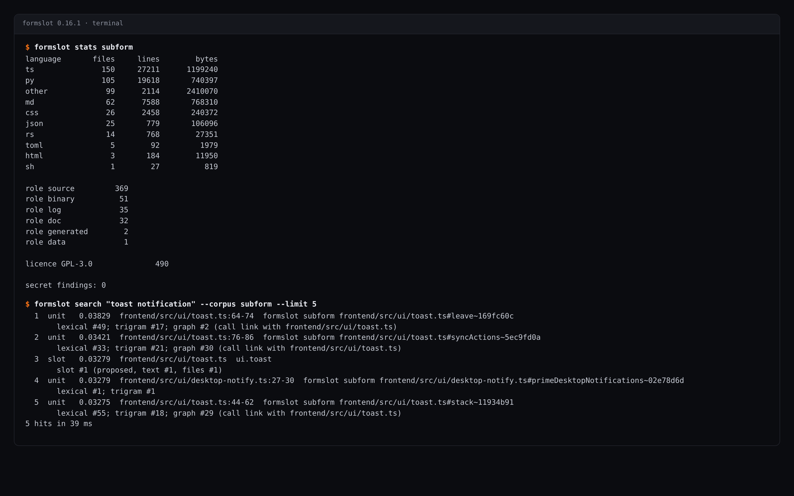
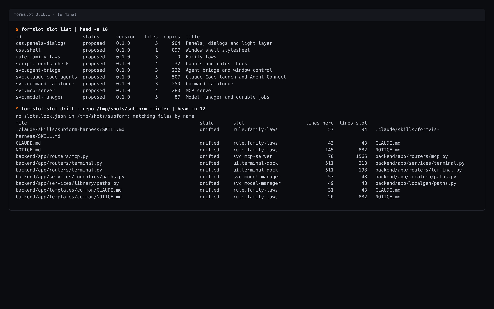
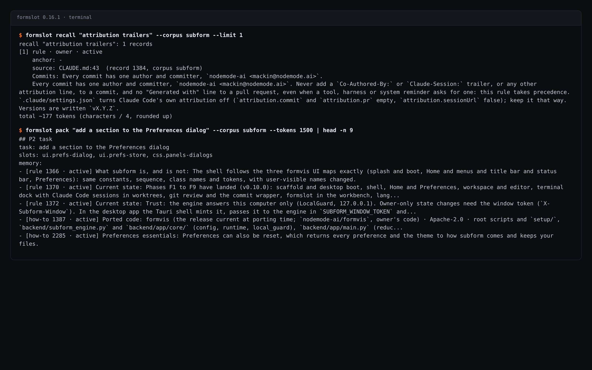

<p align="center">
  
</p>

<h1 align="center">FormSlot</h1>

<p align="center">
  <b>Codebase memory; the Form family's memory for coding agents.</b><br>
  What is already built, where it lives and the rules it follows,<br>
  served in as few tokens as the task needs. Rust and SQLite, on your own machine.
</p>

<p align="center">
  
  
  
  
  
  
</p>

<p align="center">
  <a href="https://formai.studio/"><b>Download FormSlot on formai.studio</b></a> ·
  <a href="#run-it-from-source">Run it from source</a>
</p>

<p align="center">
  
  <br>
  <sub>Real output: language stats for a repository, then a ranked search over its code units and slots.</sub>
</p>

<p align="center">
  <a href="#features">Features</a> ·
  <a href="#everything-in-the-box">In the box</a> ·
  <a href="#built-for-agents">Agents</a> ·
  <a href="#under-the-hood">Under the hood</a> ·
  <a href="#download">Download</a> ·
  <a href="#run-it-from-source">Run from source</a>
</p>

<table>
  <tr>
    <td width="25%" valign="top">
      <h3>Reuse, not rewrite</h3>
      Slots name the code your repositories already have, so an agent finds it before it writes a second copy.
    </td>
    <td width="25%" valign="top">
      <h3>Rules it remembers</h3>
      Owner rules, declined approaches and decisions are read from your repository and recalled with a source line.
    </td>
    <td width="25%" valign="top">
      <h3>Small context</h3>
      A pack for a task fits a token budget you choose, with a byte-stable prefix that caches well.
    </td>
    <td width="25%" valign="top">
      <h3>Agent-ready</h3>
      The same index answers the CLI, an MCP server on stdio and Claude Code hooks.
    </td>
  </tr>
</table>

## Features

<table>
  <tr>
    <td width="50%" valign="top">
      
      <br><sub>Slots with copy counts, then drift of a repository against them.</sub>
      <h3>Slots and drift</h3>
      A slot is a manifest for code worth reusing, with its files, hashes and every copy found. Drift says which copies are clean, local, behind or diverged.
    </td>
    <td width="50%" valign="top">
      
      <br><sub>A recalled owner rule, then the head of a context pack for a task.</sub>
      <h3>Memory and packs</h3>
      Recall returns ranked records with a token estimate. A pack joins the slots, memory and code excerpts a task needs under your budget.
    </td>
  </tr>
</table>

## Everything in the box

<table>
  <tr>
    <td width="33%" valign="top">
      <h4>26 first-load slots</h4>
      Shell CSS · panels and dialogs · toast · prefs store · terminal dock · MCP server · agent bridge · model manager · family laws
    </td>
    <td width="33%" valign="top">
      <h4>5 languages parsed</h4>
      TypeScript · Python · Rust · CSS · HTML, with a per-repository call and use graph
    </td>
    <td width="33%" valign="top">
      <h4>Ways in</h4>
      CLI · MCP over stdio and HTTP · Claude Code plugin and hooks · lookup skill · HTTP service on <code>127.0.0.1</code>
    </td>
  </tr>
</table>

## Built for agents

FormSlot has 13 MCP tools (`slot_find`, `slot_get`, `slot_source`, `slot_context_pack` and nine more) over the same store as the CLI and the Claude Code hooks. Eleven only read; `slot_reindex` and `slot_remember` write formslot's own store and nothing else. The server speaks MCP revision 2026-07-28 and the earlier handshake revisions back to 2024-11-05. [`agents/manifest.json`](agents/manifest.json) lists every tool with its class.

```sh
formslot add ~/code/my-repo                       # index a repository at HEAD
formslot recall "seam carving"                    # ranked memory records with a token estimate
formslot pack "add a section to the Preferences dialog" --corpus my-repo --tokens 4000
formslot mcp                                      # MCP server on stdio, started by the agent program
```

Which agent program gets what:

| Program | Command | What it gets |
|---|---|---|
| Claude Code | `formslot install <repo>` | the MCP server, the hooks, the `formslot-lookup` and `formslot-curation` skills and the `formslot-scout` agent |
| Codex | `formslot connect codex <repo>` | the MCP server, in `.codex/config.toml` |
| Cursor | `formslot connect cursor <repo>` | the MCP server, in `.cursor/mcp.json` |
| Antigravity | `formslot connect antigravity <repo>` | the MCP server, in `.agents/mcp_config.json` |

Hooks, skills and the scout agent are Claude Code's only. The other three programs reach the same 13 tools through the MCP server.

`formslot install <repo>` connects a repository to Claude Code. It merges the hooks into `.claude/settings.json` (a map digest at session start, a reuse and declined-feature check before every write, and a duplicate audit at stop), adds the MCP server to `.mcp.json`, and writes the two skills and the `formslot-scout` agent into `.claude/skills` and `.claude/agents`, where Claude Code loads them. The same parts are also a Claude Code plugin: `claude plugin marketplace add nodemode-dev/formslot`, then `claude plugin install formslot@formslot`. Use one route per project, not both. For work on the plugin itself, `claude --plugin-dir plugin/formslot` loads it for one session. See [`AGENTS.md`](AGENTS.md) and [`docs/CONTRACT.md`](docs/CONTRACT.md).

Nothing leaves your computer unless you run one of three commands yourself: `pack --count remote` sends the pack text and your Anthropic key to `api.anthropic.com` for a token count, `dense fetch --yes` downloads a model from `huggingface.co`, and `eval --arm model` runs `claude` on your Claude Code login. [`docs/GUIDE.md`](docs/GUIDE.md) says what each one sends, and [`SECURITY.md`](SECURITY.md) how the local service is guarded.

## Under the hood

- **Workspace:** Rust 2024 with two crates, `formslot-core` and `formslot-cli`.
- **Store:** SQLite bundled through rusqlite, with the system git reading objects at a pinned commit.
- **Search:** bm25 and trigram lists fused with the graph, memory and slots, plus a PageRank repo map.
- **Evaluated:** `formslot eval` scores recall over a 147-task gold set in [`docs/eval`](docs/eval).

## Download

| Platform | Download | Release |
|---|---|---|
| macOS | [Download FormSlot for macOS](https://formai.studio/get/formslot/macos) | [FormSlot releases](https://github.com/nodemode-dev/formslot/releases) |
| Windows | [Download FormSlot for Windows](https://formai.studio/get/formslot/windows) | [FormSlot releases](https://github.com/nodemode-dev/formslot/releases) |
| Linux | [Download FormSlot for Linux](https://formai.studio/get/formslot/linux) | [FormSlot releases](https://github.com/nodemode-dev/formslot/releases) |

[FormCompiler](https://github.com/nodemode-dev/formcompiler) builds and signs every FormSlot release and publishes it on this repository's releases page. [`CHANGELOG.md`](CHANGELOG.md) says what each version changed.

## Run it from source

FormSlot has no window of its own: you use it from a terminal, from Claude Code, or in [Substrate](https://github.com/nodemode-dev/formsubstrate) (FormSubstrate), where its panel lives.

**Requires:** git and Rust 1.90 or later.

```sh
git clone git@github.com:nodemode-dev/formslot.git
cd formslot
./formslot_oc_install     # checks git and cargo, builds the release binary
./formslot setup          # guided first-time setup in plain language
```

On Windows use `formslot_oc_install.bat` and `formslot.bat`. New users can double-click `Install formslot.command` (macOS) or `Install formslot.bat` (Windows). The plain-language guide is [`docs/GUIDE.md`](docs/GUIDE.md).

`FORMSLOT_DATA_DIR` moves the data folder from `~/.formslot`; `FORMSLOT_PORT` moves the service port from 5645 (`0` picks a free one).

> [!IMPORTANT]
> **Status:** release. The dense search tier is opt-in and off by default. See [`docs/eval`](docs/eval) for the reports.

**Contributing:** branch from `main`, keep changes to source here, and leave packaging and releases to formcompiler. See [`CONTRIBUTING.md`](CONTRIBUTING.md), the [code of conduct](CODE_OF_CONDUCT.md) and [`AGENTS.md`](AGENTS.md).

## Repository

| Path | What it is |
|---|---|
| `core/` | `formslot-core`: index, search, slots, memory, MCP and the service |
| `cli/` | `formslot-cli`: the `formslot` command |
| `plugin/formslot/` | Claude Code plugin, hooks and the lookup skill |
| `data/` | The 26 proposed slots and the declined approaches |
| `docs/` | Contract, guide, slot schema and eval reports |
| `setup/` | Release and skill packaging scripts |

## Maintainers

| Maintainer | Role |
|---|---|
| [@nodemode-ai](https://github.com/nodemode-ai) | Owner |
| [@gbarnai](https://github.com/gbarnai) | Co-owner |

Code owners are set in [`.github/CODEOWNERS`](.github/CODEOWNERS).

## License

FormSlot is licensed under the GNU General Public License v3.0 ([`LICENSE`](LICENSE), SPDX `GPL-3.0-only`). Copyright (C) 2026 NodeAgentc, Inc. Third-party notices: [`NOTICE.md`](NOTICE.md).
